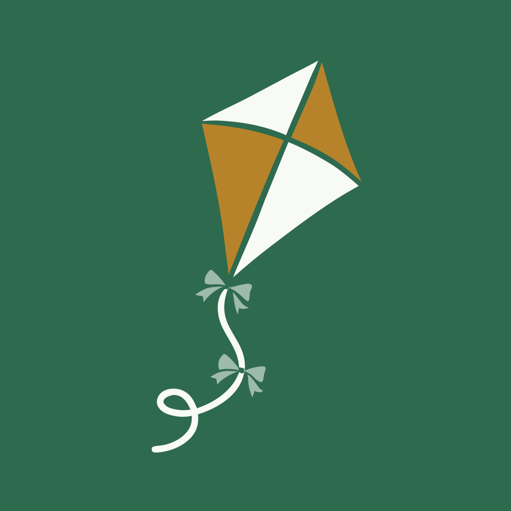
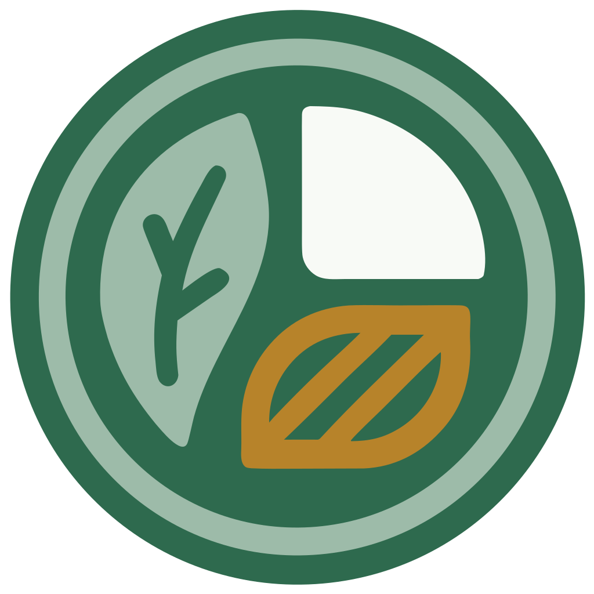

# Untethered Citizens brand guidelines

**Version 0.1 (October 2026).** This is an early version. It will change as more projects and a website arrive.

These guidelines are for anyone building an Untethered Citizens project, writing about one, or making their own version of one.

## What the brand stands for

Untethered Citizens is a home for hobbyists and enthusiasts who build everyday software for each other. The brand should feel:

- **Friendly and plain-spoken.** Write for someone who has never heard of an API key. Explain any term the first time it appears.
- **Honest.** Say what something costs, say when a number is an AI estimate, and never over-promise.
- **Handmade, not corporate.** Calm colours, simple flat shapes, no hype.

Every project keeps the same promises: free and open source, bring your own AI, no accounts, no ads, analytics or tracking, and no subscriptions.

## Names

| Name | Use it for |
|---|---|
| **Untethered Citizens** | The organization and community as a whole. |
| **Untethered Calories** | The iPhone food log. Its iOS Home Screen name is just "Calories". |
| **Bring your own AI** | How our apps use AI: you add your own AI key and pay the provider directly. Spell it out; the acronym "BYOAI" already means something else in workplace IT. |

New projects are named "Untethered *Something*", where *Something* is a plain word for what the app does.

## Logos

| Mark | Files | Use it for |
|---|---|---|
|  | [SVG](brand/untethered-citizens-kite.svg) · [PNG](brand/untethered-citizens-kite-1024.png) | **Untethered Citizens.** A kite flying free on a loose, untied string. |
|  | [SVG](brand/untethered-calories-plate.svg) · [App icon PNG](brand/untethered-calories-app-icon-1024.png) | **Untethered Calories.** A plate of food seen from above: greens, grains and a protein. |

Each app gets its own simple mark, in the same flat style and colours, so the family looks related.

**Do:**
- Use the files as they are, at any size from 20 px up.
- Leave clear space around a mark, at least a quarter of its width.
- Put the kite on its brand-green square, and the plate on a light or dark background.

**Don't:**
- Recolour, stretch, rotate, outline or add shadows or gradients.
- Add text inside a mark, or combine it with another logo.
- Use a mark for a project that isn't ours, including your own version of one of our apps (see "Using our names and logos" below).

## Colours

The core four, used in every mark:

| Colour | Hex | Role |
|---|---|---|
| Brand green | `#2E6A4E` | The main brand colour: backgrounds for marks, buttons, headings |
| Sage | `#9DBBA9` | Soft fills and accents |
| Ochre | `#B7832A` | Warm accent. A fill colour only: too light for text |
| Off-white | `#F8FAF6` | Light surfaces, and the light parts of marks |

The full app palette, with light and dark values:

| Token | Light | Dark | Use |
|---|---|---|---|
| background | `#EDF1EB` | `#131915` | Screen background |
| panel | `#F8FAF6` | `#1B221D` | Cards and rows |
| ink | `#1E2A23` | `#E4EBE5` | Main text |
| muted | `#5B695F` | `#9AA89F` | Secondary text (passes WCAG AA) |
| rule | `#D5DDD3` | `#2B352E` | Dividers |
| green | `#2E6A4E` | `#6FBE93` | Brand, primary buttons |
| greenSoft | `#9DBBA9` | `#3F6B53` | Soft fills |
| ochre | `#B7832A` | `#DDB05A` | Accent fills |
| ochreInk | `#8A5D12` | `#DDB05A` | Ochre text |
| plum | `#9A3C58` | `#DB7A9B` | Warnings, "over target" |

Every screen must work in light and dark mode, and text must meet WCAG AA contrast. Never rely on colour alone to carry meaning.

## Type

- **[Barlow](https://fonts.google.com/specimen/Barlow)** for text.
- **[Barlow Condensed](https://fonts.google.com/specimen/Barlow+Condensed)** for numbers and section titles, with tabular (even-width) figures so columns of numbers line up.

Both are free under the [SIL Open Font License 1.1](https://openfontlicense.org/), so any project can bundle them. In apps, text sizes follow the system's text-size setting (Dynamic Type on iPhone).

## Writing

- Short sentences and everyday words. Say "your AI key", not "credentials".
- Put a unit on every number: "1,850 cal", "42 g", "3 days".
- Tell people where to tap using what their device actually shows, for example "Settings → Privacy & Security → Health → Calories".
- When something costs money, say so plainly and say who gets paid.

## Using our names and logos

Our code is free to use under the [Apache License 2.0](https://www.apache.org/licenses/LICENSE-2.0). Our names and logos are **not** covered by that licence (section 6).

- **You can** use the names and logos to talk about our projects: in articles, reviews, videos, tutorials, or a link to an app.
- **You can't** use them for your own product or your own version of one of our apps, or in a way that suggests we made or endorse something we didn't.
- **If you publish your own version** of one of our apps, give it its own name and icon. Mentioning that it's "based on Untethered Calories" is fine.

Not sure? Ask in our [community discussions](https://github.com/orgs/Untethered-Citizens/discussions).
